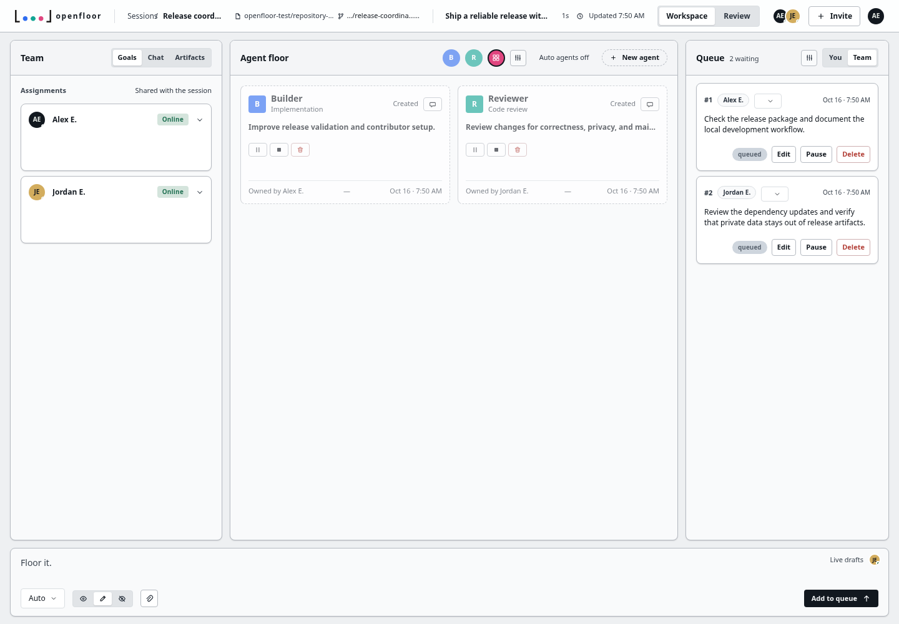
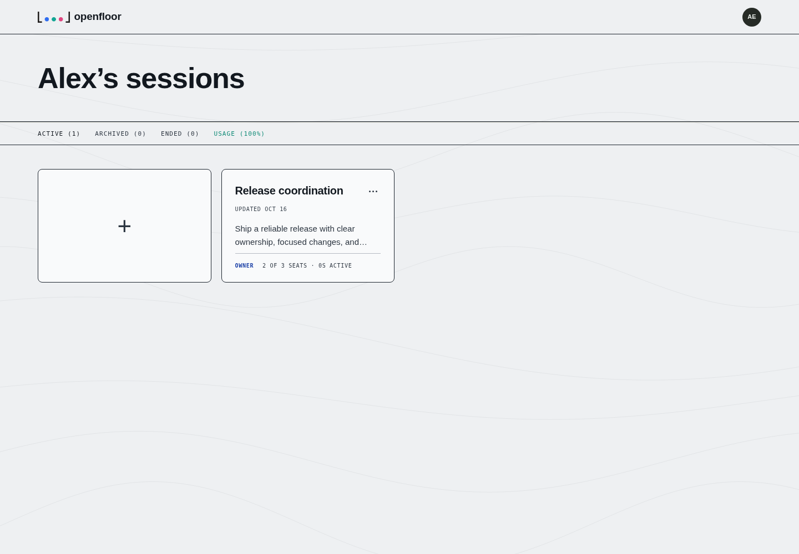

# openfloor

openfloor is a multiplayer workspace for people coordinating coding agents. Cloudflare D1 stores shared sessions, agents, prompts, messages, and repository state; Durable Objects coordinate live presence and teammate drafts. The [CLI and terminal client](https://github.com/mattdomingo/openfloor-cli) uses the same APIs.

The source is licensed under [Apache 2.0](LICENSE). See [CONTRIBUTING.md](CONTRIBUTING.md) for the development workflow and [SECURITY.md](SECURITY.md) for private vulnerability reporting.

## Project status

Durable collaboration, GitHub installation and repository flows, provider credential management, and review are implemented. New sessions start empty, and the UI never invents agent work or results. See [implemented features](docs/implemented-features.md) and [known limitations](docs/known-limitations.md).

**Agent execution is currently disabled by a security hold.** Provider CLIs and repository-controlled commands share a Linux user, allowing same-user process inspection to expose a gateway token. Keep `AGENT_RUN_ENABLED=false` until a separate-user or equivalent boundary passes adversarial container testing. The local UI and isolated automated tests work with execution disabled.

## Screenshots

The Agent Floor brings shared goals, agents, and a prompt queue into one workspace. It supports light and dark themes.

<picture>
  <source media="(prefers-color-scheme: dark)" srcset="docs/images/agent-floor-dark.png">
  <source media="(prefers-color-scheme: light)" srcset="docs/images/agent-floor-light.png">
  
</picture>

The session list keeps active, archived, and ended work together.



Screenshots were captured from the running app with isolated test accounts and repository fixtures. They contain no production data or credentials, and do not depict live agent execution. See [screenshot provenance](docs/images/README.md).

## Local development

Requires Node.js 22.13 or newer and npm 11.19.1. CI uses Node 22. Install the pinned npm version if needed:

```bash
npm install -g npm@11.19.1
npm ci
npm run setup:local
npm run db:migrate:local
npm run dev:local
```

The app serves at the root, normally `http://localhost:3000`; use `/home`, not `/app/home`.

`setup:local` creates ignored `.dev.vars` with a loopback development identity and random local secrets. It also creates ignored `.wrangler.local.jsonc`, disabling container builds, remote preflight, agent execution, and paid checkout. Both existing files are preserved, including any overrides you have added. No Cloudflare account, Docker daemon, provider key, or GitHub App is required for this initial workflow.

Local sign-in uses `OPENFLOOR_DEV_USER_*` only on loopback hosts. First-run onboarding can render without external integrations; completing real GitHub onboarding and creating repository-backed sessions requires your own GitHub App. The browser suite exercises these flows with isolated, test-only fixtures. Never enable test identity headers in a deployment.

After changing bindings in `wrangler.jsonc`, update your local override to match. For container development, use the original `npm run dev` path with Docker running and configure the required integrations deliberately. `.env.example` lists configuration names; never commit real values.

## Checks

```bash
npx playwright install --with-deps chromium
npm test
npm run build
npm run verify:deploy-artifact
```

`npm test` runs type checking, lint, unit tests, D1 migrations, Worker and Durable Object tests, rendered-app tests, and the two-user browser suite. Tests supply their own local fixtures and do not need production credentials. Run build/render/browser commands sequentially because they share `dist/`.

The browser suite writes a test-configured build into `dist/`. Always build again and verify the artifact before deployment. See [testing strategy](docs/testing-strategy.md) for the individual suites.

## Self-hosting and deployment

The hosted service uses Cloudflare Workers, D1, Durable Objects, Workflows, R2, Access, and Sandbox containers. GitHub Apps, provider accounts, and Stripe are separate integrations with their own configuration and terms.

The checked-in Wrangler configuration and artifact verifier describe the hosted openfloor deployment. Its public domain, resource names, and database ID are identifiers, not credentials. For your own deployment, provision your own resources and update those identifiers **and the verifier's exact expected values** together. Preserve the test-variable checks and closed agent-execution gate. Do not point a fork at another installation's resources.

Read [deployment configuration](docs/deployment-config.md), [GitHub setup](docs/github-production.md), [Cloudflare Access](docs/cloudflare-access-config.md), and [Stripe billing](docs/stripe-billing.md) before deploying. CI validates pull requests; pushes to `main` additionally attempt the documented production deployment using repository-scoped Cloudflare secrets. A fork can run checks without those secrets. Configure the fork's deployment target before enabling deployment credentials.

`deploy.sh` is the manual production path: it audits and tests before applying remote migrations, then builds, verifies, and deploys. Running it mutates the configured Cloudflare installation.

## Documentation

- [Architecture](docs/system-architecture.md), [repository map](docs/repository-map.md), and [API contracts](docs/api-contracts.md)
- [Engineering guide](AGENTS.md) and [decision log](docs/decision-log.md)
- [Release preparation](docs/open-source-release.md) and [third-party notices](THIRD_PARTY_NOTICES.md)
- [Record the website demo](docs/website-demo-video.md)

## License

[Apache License 2.0](LICENSE), with attribution in [NOTICE](NOTICE). Third-party dependencies and provider trademarks retain their own licenses and terms. The Claude Agent SDK and bundled provider executables are not relicensed by this repository; review [THIRD_PARTY_NOTICES.md](THIRD_PARTY_NOTICES.md) before redistributing a built container.
